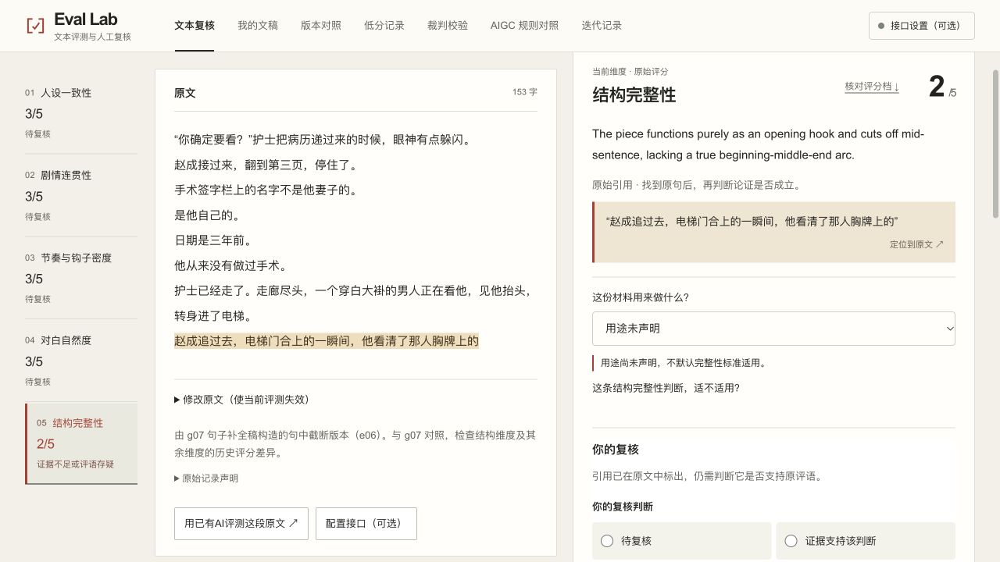
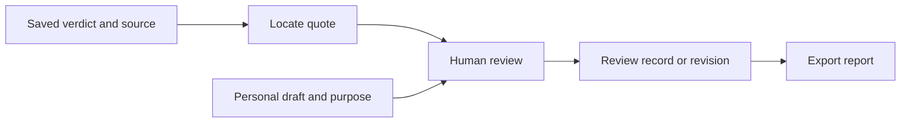

# Eval Lab

Audit model scores against source text and keep human judgments separate.

[Live demo · review e06](https://andyzhang666666.github.io/llm-output-eval/?sample=e06&dimension=structure) · [Portfolio case study](https://andyzhang666666.github.io/cases/trust/) · [Architecture](#architecture)

[中文](README.md)

A scene cuts off as the protagonist reads a name badge. The saved judge gave structure **2/5**. Choose **定位到原文** to find the unfinished sentence. Would that score be fair if the author intended an opening?



[Original 16:9 capture and provenance](https://github.com/AndyZhang666666/AndyZhang666666/blob/c8760f26af49716b02feb6600a38cc73f0ac2dbb/docs/editorial/projects/eval.md)

## Why I built it

A reviewer can find the quoted sentence and still disagree with the verdict. To resolve the disagreement, they need the original assessment, the intended use of the draft and a record of their own reasoning.

## Three product decisions

1. **Keep the original score.** Editing it in place would erase disagreement. A reviewer adds a separate finding that the next reader can challenge.
2. **Start with a saved verdict.** Requiring a fresh call would make a key and a changing output part of every visit. Anyone can replay the same assessment.
3. **Tie findings to the draft version.** Carrying a finding into every revision would make it look current. A reviewer checks the passage again after each edit.

## Architecture



The browser keeps the original score and the reviewer's finding in separate fields. A personal draft can have observations and revisions without a model score. [Review logic](src/lib/review.ts) · [Purpose and rubric applicability](src/lib/review-context.ts) · [Revision workflow](docs/TASK-LOOPS-20261111.md)

## What the evaluation covers

- **Demo replay:** six texts and 18 saved outputs. The displayed 2/5 is a historical result.
- **Judge validation:** 30 examples scored against one author's labels. Among ten pairs with order reversed, none flipped winner, but four switched to abstaining. Inspect the [report and raw results](validation/judge-validation.md) before interpreting agreement.
- **Earlier rubric:** a separate [Creative Eval study](https://github.com/AndyZhang666666/creative-eval) used 40 constructed samples and 32 author-labelled cases. The samples differ across studies.

## Limits and next checks

Locating a quote establishes that the text exists. Reviewers decide whether it supports the criticism. A second independent annotator would help distinguish rubric ambiguity from judge error. A prompt or model change warrants a fresh run on a fixed set. Browser-local drafts can be lost when storage is cleared; export important reviews.

## Quick start

With Node.js 20, run from the repository root.

```sh
npm ci
npm run test:core
npm run dev
```

Open `http://localhost:3000/llm-output-eval/`. Replay and [manual draft review](https://andyzhang666666.github.io/llm-output-eval/workspace/) work without a key. [Release history](CHANGELOG.md) · [Original full guide](https://github.com/AndyZhang666666/llm-output-eval/blob/077f0ebd8522b7cd3d3367ea4ad1f6ba39d1a82e/README.en.md) · [Third-party notices](public/licenses/README.md)
