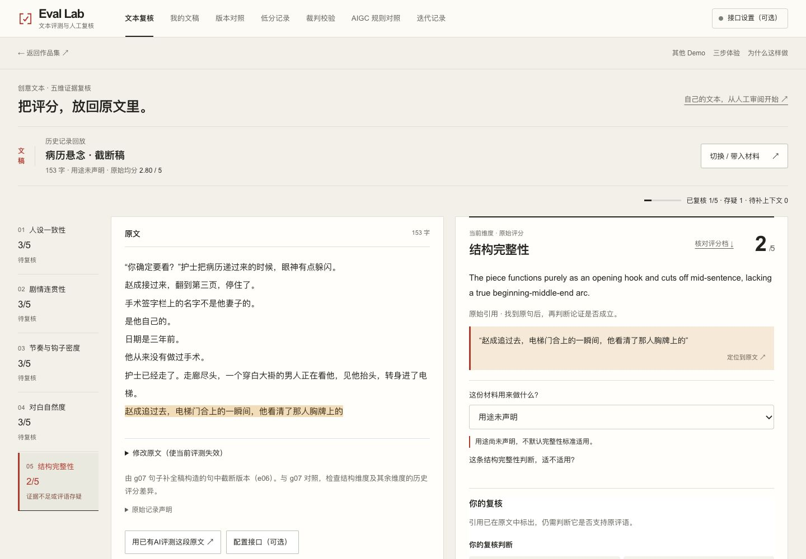
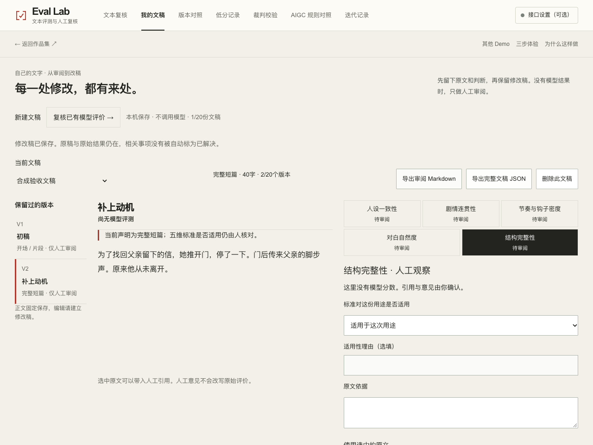

# Eval Lab

Review your own manuscript, keep the evidence behind your comments, and compare revisions. Or inspect a saved model evaluation and check whether its reasons hold up against the source.

[Review your text](https://andyzhang666666.github.io/llm-output-eval/workspace/) · [Explore historical cases](https://andyzhang666666.github.io/llm-output-eval/) · [Design decisions](docs/PRODUCT-DEPTH-20261109.md) · [中文](README.md)

> Manual review needs no model key. Historical model outputs are replayed separately; human comments never overwrite original scores.

**2026-11-12 development review, not released:** one material chooser, facing source/comment panes, a mobile return-to-comment path, one action editor and a report-format menu. Scores, rubric, import formats and storage boundaries remain intact. [Decisions and test scope](docs/WORKBENCH-CRAFT-20261112.md).





## Try a review

1. Open the manuscript workspace, paste your text, state its intended use and save a first version.
2. Quote a passage, record an observation and create a follow-up action. Save a revision and compare the two versions to see which issue each change addresses.
3. Export a readable Markdown review or a complete JSON report. Inspect and confirm the JSON import in a fresh browser to restore the manuscript and continue.

No manuscript handy? Open a [historical case](https://andyzhang666666.github.io/llm-output-eval/), select a dimension, locate its quotation and record support, doubt or a need for context.

## Why human judgement stays separate

A quotation can exist in the source while the judgement attached to it is wrong. The rubric may also be unsuitable for the text's intended use. Original scores, human evidence and revision actions are saved separately. Linking a revision to an action still leaves the reviewer to check whether the issue was resolved. A manuscript without a model evaluation is shown as unevaluated.

## Three ways to use it

| Mode | What you can do | Source and limits |
| --- | --- | --- |
| Your manuscript | Record intended use, review passages, track actions, compare versions and export a complete report | Local manual review; no model scores are generated automatically |
| Historical evaluations | Inspect 18 saved outputs across six samples, locate quotations and review the reasons | Saved-output replay, not a new model run |
| Bring back model results | Take a task package to your own AI and import its JSON; a model endpoint is also optional | External execution and metadata are user declarations; synthetic format practice is labelled separately |

The five-dimension rubric, original scores and historical calibration results remain distinct. A full library never silently evicts a record. Export important work as a backup.

2026-11-11 task loop: explicit N/A judgments can show a separate applicable-dimension reference mean. The manuscript source offers an inline diff against the preceding saved version and a current-version evaluation prompt. Calibration offers a draft Rubric Patch memo for manual review. Original scores, the original mean and the canonical rubric stay unchanged. [Behavior and local evidence](docs/TASK-LOOPS-20261111.md). Those task-loop changes are included in the `af60f5b` main baseline. The 2026-11-12 workbench polish is a separate development preview.

## Run locally

Use Node.js 20 from the complete repository root:

```sh
npm ci
npm run dev
```

Open `http://localhost:3000/llm-output-eval/workspace/`. Manual review and historical replay both work without a key.

Reproduce the deterministic checks and static build:

```sh
npm run test:core
npm run check:replay
npm run build
```

These checks do not call a paid model. Historical judge calibration has its own commands and records.

## Design and verification

[Current release · 2026-11-09](docs/RELEASE-20261109.md) · [Feature scope and data contracts](docs/PRODUCT-DEPTH-20261109.md) · [Interface design](docs/DESIGN.md) · [Historical judge calibration](validation/judge-validation.md) · [Validation records](docs/VALIDATION.md) · [Changelog](CHANGELOG.md) · [PR checks](https://github.com/AndyZhang666666/llm-output-eval/actions/workflows/checks.yml)

[All projects](https://github.com/AndyZhang666666/AndyZhang666666/blob/main/PROJECTS.en.md)

## Interface follow-up

2026-11-09: all seven mobile navigation labels remain visible; the source note follows short manuscript content. The Swiss grid, scoring and draft contracts are preserved. [Measurements, screenshots and verification scope](docs/LAYOUT-POLISH-20261109.md).

## Iteration history and earlier verification

<details>
<summary>Expand the original release notes and implementation records</summary>

The notes below retain their original wording. “Local” and “unpublished” describe the stage at each recorded date. See the [2026-11-09 release record](docs/RELEASE-20261109.md) for current scope and deployment status. Earlier feature limits and validation figures keep their original context.

2026-11-09 approved release: personal manuscript review, intended-use context, source-linked revisions, complete report roundtrips and bounded large-report/source editing. Original scores and the five-dimension rubric are unchanged. Approved source `66a13b4`; [release and deployment verification](docs/RELEASE-20261109.md). Earlier development-preview notes below remain historical records.

2026-11-09 capacity fix: genuine downloads from a 400KB legacy material roundtrip with raw/normalized transport intact. Original material remains capped at 1MB; bounded report envelopes cannot expand it. Edits over 20,000 characters stay complete with an inline notice and new-task guard, while old large reports remain reviewable/exportable. [Checks and artifact hashes](docs/REPORT-ENVELOPE-20261109.md).

2026-11-09 independent review fix: complete manuscript reports retain single-record intended-use/applicability notes separately from manuscript-version observations. Real downloads and a fresh 390px browser restore preserve both layers, original results and record IDs. [Evidence and scope](docs/REPORT-CONTEXT-20261109.md).

2026-11-09 development preview — not published: review your own text without a model, record intended use and rubric applicability, link source-bound actions to an immutable revision, compare versions and restore a complete manuscript report. Synthetic JSON practice is explicitly not a model run. The original 31 checks remain unchanged; 45 checks, lint and the static production build pass. [Scope, design and evidence limits](docs/PRODUCT-DEPTH-20261109.md).

2026-11-03 release batch: verified task clarity, draft recovery and final display/export details. [Release scope and validation limits](docs/RELEASE-20261103.md). Earlier local-only notes remain as history.

Final display/export polish verified locally; calculation and persistence contracts retained. Unpublished. [Changes and checks](docs/FINAL-DETAIL-20261103.md).

Independent task-flow rechecks passed; changes remain local and unpublished. [Review scope and untested limits](docs/INDEPENDENT-REVIEW-20261103.md).

2026-11-03 local review fixes: sibling tools open in new tabs; unfinished text is restored separately from confirmed results. No push, merge or publication. [Behavior and checks](docs/DRAFT-RECOVERY-20261103.md).

Local iteration, 2026-11-03 — not published: Imports fold and focus review after validation. Optional human reference scores never replace original scores; A/B opens disagreements first and aggregates show denominators. The AIGC comparison is an authored synthetic fixture, not a model experiment. Core checks (27), lint and the static build passed; real exported files and phone-viewport actions were inspected. [验收与边界](docs/TASK-CLARITY-20261103.md)。

Visual refresh approved after user review, 2026-11-02: [design, references and before/after screenshots](docs/VISUAL-CRAFT-20261102.md). Existing product behavior is preserved; the merge commit and Pages workflow record publication.


[中文](README.md) · [Project index](https://github.com/AndyZhang666666/AndyZhang666666/blob/main/PROJECTS.en.md) · [Live demo](https://andyzhang666666.github.io/llm-output-eval/)

Can a reviewer inspect the evidence behind a low score and disagree with the judge?

**Approved release, 2026-11-02:** Take the existing five-dimension rubric and exact judge prompt to an external AI, bring back JSON, inspect the evidence, record separate follow-up actions, and compare two personal reports without a site API key. The local library holds up to 20 records and never evicts one silently. External execution and metadata remain user declarations. Deterministic checks, a static build and integrated browser review are complete; this release ships with the portfolio. [Implementation and evidence](docs/PRODUCT-DEPTH-20261101.md).


<!-- github-evidence-20261031 -->

[Design decisions](docs/DESIGN.md) · [Validation records](docs/VALIDATION.md) · [PR core checks](https://github.com/AndyZhang666666/llm-output-eval/actions/workflows/checks.yml)

## Follow the score back to the source

- Separate dimensions and require a source passage for each judgement.
- Keep citation location distinct from human review; never overwrite the saved score.
- Retain the run, sample and prompt context in exportable records.

## Walkthrough

1. Open a historical sample and select a low-scoring dimension.
2. Locate its quotation in the source, then record support, doubt or a need for context.
3. Compare a truncated passage with its sentence-completed version, then inspect an existing complete story arc. Export original results and human reviews separately.

## Run mode and limits

The default replays 18 saved outputs across six samples without a key. A live endpoint is optional. Historical calibration results were not rerun for the current interface.

Saved model outputs and calibration results belong to their original samples and prompts. This documentation update does not rerun model evaluations or establish production accuracy. Labels and disagreements remain inspectable.

## Develop locally

```sh
npm ci
npm run dev
```

Open `http://localhost:3000/llm-output-eval/`. The repository base path is part of the URL.

## Reproduce the core checks

```sh
npm run test:core
npm run check:replay
npm run build
```

These commands are provided for reproduction; this documentation update did not run a new model benchmark.

## Documentation

- [Product scope](docs/PRD.md)
- [Interface design](docs/DESIGN.md)
- [Historical judge calibration](validation/judge-validation.md)
- [Validation records](docs/VALIDATION.md)
- [Implementation details and original records, Chinese](README.md)

Use the repository’s existing licence and notices. This update does not change usage rights.

[PR core checks](https://github.com/AndyZhang666666/llm-output-eval/actions/workflows/checks.yml) reuse the deterministic checks and static build. Only the main-branch Pages workflow deploys.

## Personal inputs and portable results · 2026-11-01

This update adds personal inputs and a portable result, with the reviewed implementation integrated through a release branch. The main review flow works in the browser without a model key. Imports are unverified; original scores and 18 historical runs stay intact. Human review is exported separately and does not grant publication approval.

</details>
