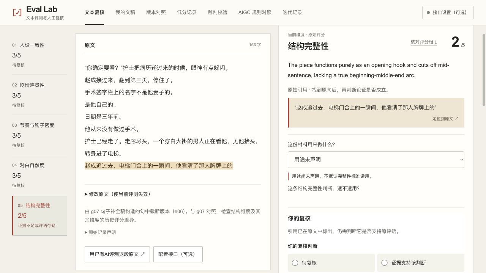
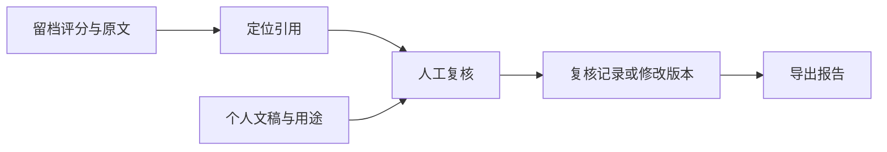

# Eval Lab · 文本评测工作台

回到原文核对模型评分，单独记录审阅者的判断。

[在线复核 e06](https://andyzhang666666.github.io/llm-output-eval/?sample=e06&dimension=structure) · [作品集案例](https://andyzhang666666.github.io/cases/trust/) · [架构](#架构)

[English](README.en.md)

主角刚看清对方的胸牌，故事就断了。历史裁判给结构完整性打了 **2/5**。点击「定位到原文」找到断句。如果作者交来的是开场，这条扣分理由还成立吗？



[16:9 原始截图与拍摄记录](https://github.com/AndyZhang666666/AndyZhang666666/blob/c8760f26af49716b02feb6600a38cc73f0ac2dbb/docs/editorial/projects/eval.md)

## 为什么做

两位审阅者可以找到同一句话，却对扣分有不同意见。要讨论清楚，原始评语、文稿用途和各自的判断都得留下来。

## 三个取舍

| 选择 | 考虑过的做法 | 采用这个选择的原因 |
| --- | --- | --- |
| 单独保存人工意见 | 直接改模型分数 | 下一位审阅者能看清分歧从哪里来。 |
| 默认打开留档评分 | 入场先调用一次模型 | 访客无需密钥，就能复核同一条输出。新模型运行可以单独安排。 |
| 观察关联具体版本与原句 | 自动把结论带入每份改稿 | 改了字也可能没有解决问题，下一版仍要复核。 |

## 架构



浏览器分别保存原分与审阅意见。个人文稿可以只有观察和版本记录。[复核逻辑](src/lib/review.ts) · [文稿用途与量表适用性](src/lib/review-context.ts) · [改稿流程](docs/TASK-LOOPS-20261111.md)

## 如何读验证结果

- **公开回放**有 6 篇文本、18 次保存输出。示例中的 2/5 来自历史评测。
- **历史裁判校验**另取 30 条样本，由作者一人标注。10 对样本交换顺序后，0 对翻判，4 对改为不表态。解读一致率时应同时看弃判。[报告与原始结果](validation/judge-validation.md)
- **前一期量表实验**用了 40 条构造样本，其中 32 条有作者标签。两期使用不同样本，无法据此计算质量提升。[Creative Eval](https://github.com/AndyZhang666666/creative-eval)

## 边界与下一步

引用定位只证明原句存在。它是否支持批评，还得结合文稿用途来判断。下一步值得请第二位标注者独立评分，区分量表歧义和裁判误差。改提示词或换模型后，需要在固定样本上重测。浏览器清理存储会丢失本地文稿，重要记录可先导出。

## 本地运行

使用 Node.js 20，在仓库根目录运行。

```sh
npm ci
npm run test:core
npm run dev
```

打开 `http://localhost:3000/llm-output-eval/`。历史回放和[个人文稿审阅](https://andyzhang666666.github.io/llm-output-eval/workspace/)均可免 Key 使用。[更新记录](CHANGELOG.md) · [原版完整指南](https://github.com/AndyZhang666666/llm-output-eval/blob/077f0ebd8522b7cd3d3367ea4ad1f6ba39d1a82e/README.md) · [第三方许可](public/licenses/README.md)
