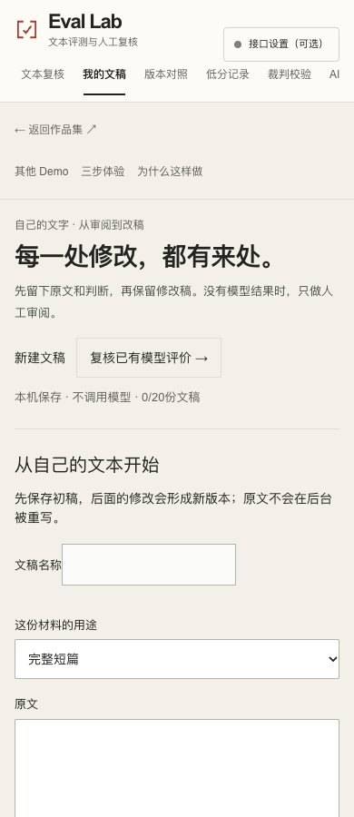
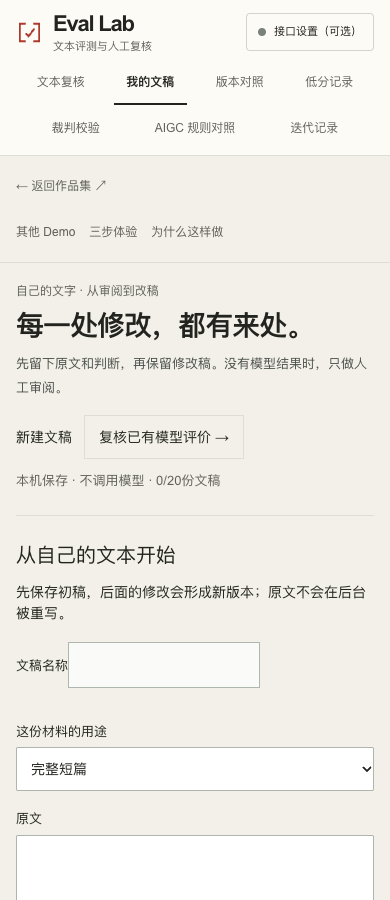
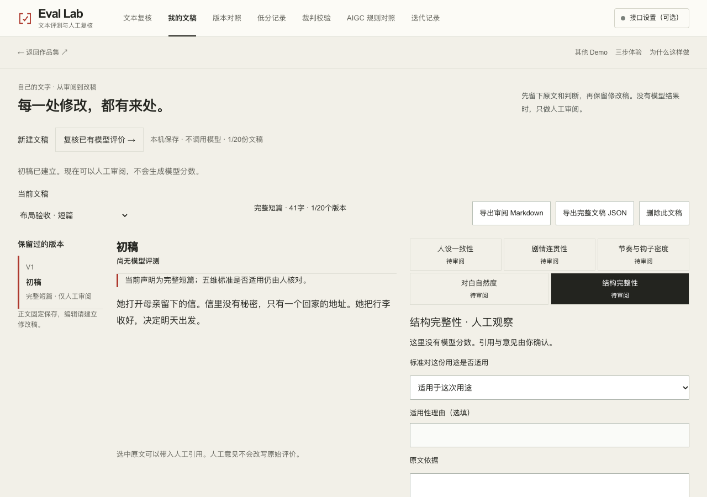
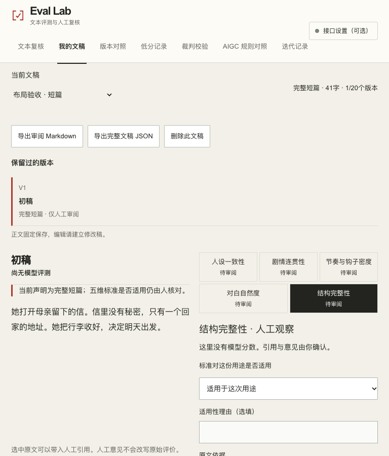
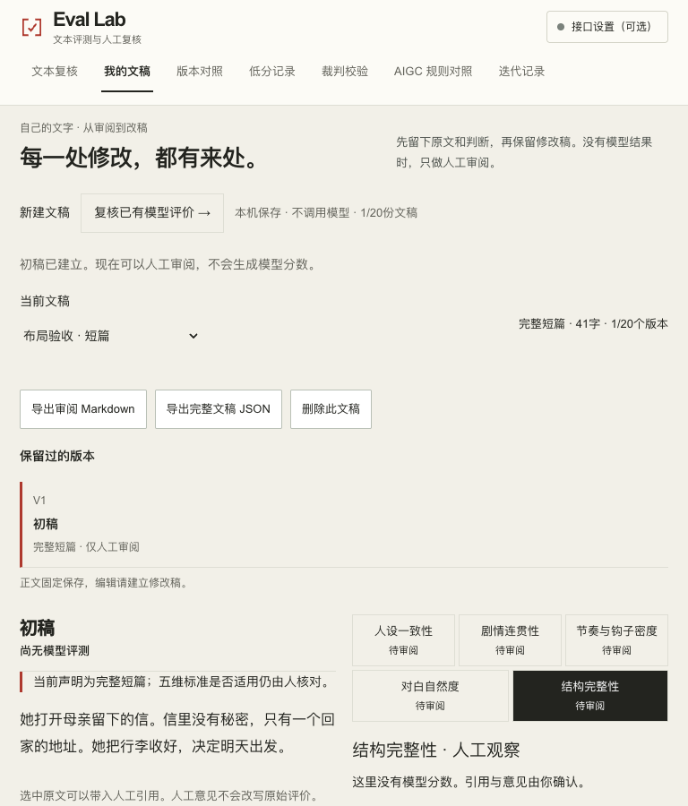

# Eval Lab · 导航与短文稿布局打磨

本轮基于真实远端主线 `6f3f6ae525475791b4edf5fcd21c8f726e60ffa8`，保留此前批准功能源码 `66a13b4` 的全部祖先提交。只改导航样式和人工文稿正文最小高度；五维评分、公式、状态机、草稿与报告格式保持不变。

## 复现与修复

| Before | After | 原因 |
| --- | --- | --- |
| 390px导航容器358px，内容503px；AIGC规则仅露出开头，迭代记录不可见 | 358px容器与内容一致，七项按4+3完整两行显示，保留44px点击区、当前项下划线与内部键盘焦点 | 不依赖半个标签暗示横滑；长标签放在更宽的第二行 |
| 平板品牌与七项导航相互挤压，接口设置换行 | 1100px以下品牌／接口在第一行、导航独占下一行 | 三种宽度共享完整目的地名称，保持瑞士网格 |
| 同一41字原创短文稿正文保留280px最小高度；实际文字尾至引用提示222.61px | 正文高度随内容自适应，文字尾至提示35.39px | 消除人为撑开的空洞，原稿与人工表单仍各自按内容排版 |

桌面1280px原单行导航保持。没有隐藏项目、缩短标签、增加菜单状态或修改文稿组件逻辑。

## 实际检查

- 1280×900、768×900、390×900：无页面横向溢出，七项导航默认完整显示；键盘Tab逐项聚焦时标签与焦点均在可见区。
- 390px实际依次进入全部七个页面，当前项下划线与`aria-current`对应正确。
- 41字原创虚构材料：人工意见、建立修改稿、JSON／Markdown真实下载；原稿和人工意见保留，未生成模型分数。
- 全新390px、减少动态效果环境恢复实际下载报告，重新导出的文稿内容完全一致。
- 现有45项核心检查原断言未改且全部通过；历史回放生成、lint、TypeScript及生产静态构建通过。
- 不调用模型，不使用真实用户数据，不据此声称模型或实际用户效果。

### 前后证据

[公开旧版测量](assets/layout-polish-20261109/before/measurements.json) · [本地开发预览测量](assets/layout-polish-20261109/after/measurements.json)

| 宽度 | 修改前 | 修改后 |
| --- | --- | --- |
| 390导航 |  |  |
| 1280短文稿 |  |  |
| 768短文稿 |  |  |

其余宽度截图、实际JSON／Markdown与恢复文件在相同目录。完整本地使用路径及`after/measurements.json`来自成功的开发预览检查；后续静态检查更新了部分导航、文稿截图，但曾在草稿初始化等待处超时，独立诊断又能正常操作，原因未确认，不能据此声称静态全流程稳定通过。评分、草稿与组件逻辑没有为检查改写。公开版本将通过CI干净构建，再在PR单独记录实际部署与公开页面结果；不把推送或开发预览当作上线验证。
