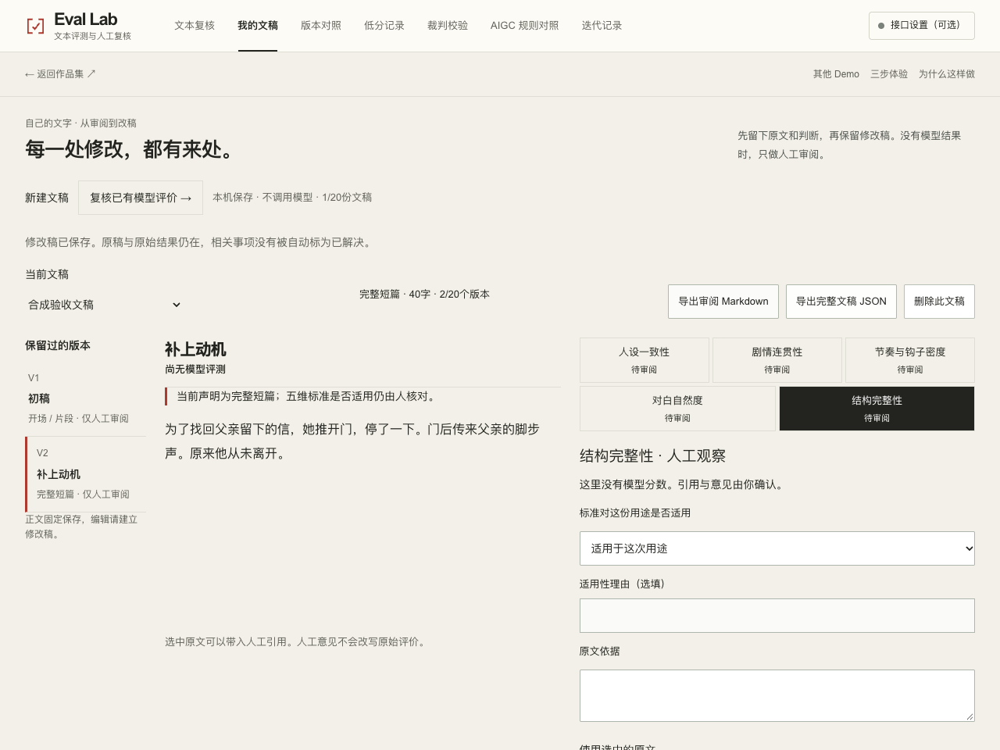
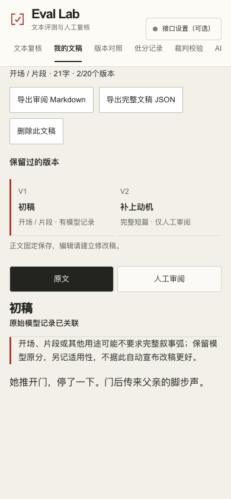

# Eval Lab：从审读评价到保留改稿依据

状态：开发分支 `feat/eval-product-depth-20261109`，本地审阅候选。基线为 `65c811e`。本文件不代表合并、部署或线上验收。

## 这轮要解决什么

旧版能核对评语，却要求访客先拥有模型输出。真正带一段原文来的作者，应该能先读、留下疑问，再决定是否让模型评价。修改之后也需要知道：改了哪一处、针对什么问题、是否真的重新审过。

因此保留两种清楚的对象：

- 原始模型结果沿用既有 `sourceText / originalResult / reviews`、稳定标识及五维分数。
- 新的纯人工文稿独立保存正文版本、用途、人工依据与处理项。没有 `originalResult`，也不产生 0 分或代造评分。

首页并列“先复核一个案例”与“使用我的文本”。已有原文也可以留在主评审台通过外部任务包带回结果；来源声明在次级展开区。

## 可以实际完成的任务

### 只带自己的原文

进入“我的文稿” → 声明用途并保存初稿 → 选择维度 → 引用原句、记录观察及标准适用性 → 建立处理项 → 选择本次要处理的问题 → 保存修改稿 → 对照原稿 → 导出审阅记录。

原稿和修改稿是不同版本。处理项携带维度、来源编号及可选原句；关联到修改稿不勾选完成、不自动证明问题已解决。初稿与修改稿的模型原分都显示“尚无模型评测”，直到用户带回完全同文的实际结果或明确的合成练习。

每份文稿最多20个版本，工作区最多20份文稿；不自动淘汰。文稿可单独删除，模型资料和模型复核保留。未确认的编辑仍是标签页草稿。存储损坏时保留旧值，本页仍可操作和导出。

### 带回一份结果

现有 JSON 上传与任务包继续保留。纯 JSON 或一个完整 JSON 代码块可导入；仅去掉围栏与首尾空白。混合说明、多段代码、非法分数和不一致均分都拒绝。精确原始粘贴与规范化文本作为 `transport` 元数据保存，不参与原文/原始结果的内容标识。

“填入示例评测 JSON”根据当前文字生成可定位的格式练习。它强制声明 `sample:true`、`合成示例 · 非模型运行`，不认证模型、Prompt 或服务商运行。所有3分只是格式展示，不是对用户文字的评价。已有返回草稿被替换前需要确认。

模型评价的用途及逐维适用性另存在 `review-contexts:v1`，不改 `originalResult`、不改均分、不当作金标。选择“不适用于这次用途”必须写原因。开场/片段提示结构完整性的适用边界；旧记录默认用途未声明。

### 对照并带走结果

文稿版本对照展示正文变化区域、五维原分、原始评语/引用、已有中文释义、人工观察与复核争议、关联处理项。一个版本关联多份结果时可明确选中要对照的原记录。缺少模型条件、用途不同或至少一侧没有模型评价均显示限制；不输出自动胜者。

已有资料库的 A/B 对照保留同文多次记录聚合，并增加用途差异提示及适用性说明。单次记录始终只是一次观察。

导出包括：

- `eval-review.md`：人工支持/存疑/需上下文分布、优先校准维度、未解决事项、用途与适用性、原始五维、原评语和已有中文释义。
- `eval-review.json`：旧版 v1 模型报告兼容，补充独立上下文及原始粘贴记录。
- `eval-manuscript-review.md`：未解决问题在前，附版本、用途、原文、人工依据、改稿事项及关联模型原记录。没有模型时明确为人工审阅。
- `eval-manuscript-review.json`：v2 文稿容器，保留原始模型快照与人工处理项；关联结果即使后来从资料库移除，文稿备份仍可读。上传/粘贴先检查，再展示影响，确认后恢复。错文关联、坏报告或无关结果不写入任何一半。

## 展示与交互

保留象牙纸、深墨、克制的红色信号及瑞士网格。主对象是正文，不以新增仪表盘代替阅读。

桌面用窄版本目录、原文与人工批注并置；手机切换原文/审阅，当前维度和未保存编辑不丢。按钮、选择器及当前任务触点至少44px。版本切换使用短颜色/按压反馈；减少动态效果时全部任务仍可完成。

历史 g07 仅改展示名为“病历悬念 · 句子补全稿”，ID、原文、原分、原链接保留。提示通过原始评语核对“句子补全”与完整叙事弧的区别；不改历史样本来配合文案。

## 数据兼容与限制

| 对象 | 约定 |
|---|---|
| 模型记录 | v1、单份JSON最大1MB、资料库最多20份，原始五维/均分与标识保持 |
| 原文编辑 | 新建/修改最多20,000字符；既有报告继续按原有读取规则 |
| 纯人工文稿 | 独立v2，最多20份 × 20版本，工作区8MB；完整报告24MB |
| 适用性 | 独立人工解释层；不进入原分或裁判一致率 |
| 人工处理 | 最多500项，来源可追踪；完成≠重新评测≠已解决 |
| 外部运行 | 用户声明，未认证；合成示例与历史记录均有明确来源 |

本轮不改五维锚点、Prompt、评分/聚合算法、历史校验输出或真实接口调用方式。没有付费模型请求、线上追踪或真人效率实验。

## 验证记录

现有31项核心检查原样保留；本轮增加10项状态、导入与版本关系回归，41项通过。ESLint、TypeScript、校验编译与 webpack 静态生产构建通过。核心测试使用合成资料，不证明模型效果。

本机 Chrome 无头模式通过以下实际界面操作，全部使用新浏览器上下文与合成验收资料：

| 检查 | 实际结果 |
|---|---|
| 纯人工路径 | 自己的原文、开场用途、不适用原因、原句、人工意见、带来源处理项、修改稿、不同用途提示、JSON/Markdown下载通过；两版无虚构模型分数 |
| 合成返回路径 | 快捷填入→导入→存疑判断→即时校准小结→用途/适用性→下载通过；原始均分仍3，始终`sample:true` |
| 原文绑定 | 同文评测可关联；不同原文被拒绝，原稿与已关联结果保持 |
| 完整恢复 | 在干净上下文上传导出的文稿JSON，检查后先展示影响；确认前无材料变更，确认后两版及关联原始结果可读 |
| 版式与操作 | 1280、768、390px无页面横向溢出；手机原文/审阅切换、44px任务触点、键盘Tab、减少动态效果通过 |
| 运行边界 | 当前任务无前端异常，无外部请求；没有模型API或付费调用 |

复验脚本为 `scripts/test-product-browser.mjs`，结构与导入回归为 `scripts/test-product-depth.mjs`。第一次浏览器检查测到移除按钮只有34px，修正为44px后复验通过。结果摘要见 [browser-results.json](assets/product-depth-20261109/browser-results.json)，[核心检查原始输出](assets/product-depth-20261109/core-tests.txt)、[生产构建输出](assets/product-depth-20261109/build.txt)与[被验证源码提交](assets/product-depth-20261109/source-commit.txt)一并保留。

这些是桌面Chrome的手机/平板宽度模拟，不是实体iPhone、屏幕阅读器或真人可用性研究。未覆盖的真实服务商调用、长期使用和多人盲评不能视为已验收。发布由整合审阅后的独立流程处理。
