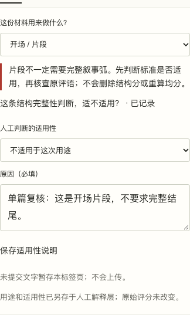

# 独立走查修复：完整文稿报告保留两种人工解释

2026-11-09，本地开发分支；尚未推送、合并或发布。

## 实际发现的问题

在 `5550197` 上通过隔离Chrome复现：

1. 使用自有原文和明确标为合成的示例返回，进入单篇证据复核。
2. 将用途设为开场，保存结构判断“不适用”和原因。
3. 把同文带入改稿工作区，保存初稿，关联已有同文结果。
4. 导出完整文稿JSON及Markdown。

单篇报告正确包含 `reviewContext`，完整文稿的 `assessments[0].reviewContext` 却为空，Markdown也缺少刚写的理由。文稿版本中的人工观察被当成该模型记录的适用性说明使用，混淆了两个解释层。原始模型分数没有被改写，坏JSON也没有覆盖文稿；本次修复针对解释内容丢失。

## 修复后的行为

- 完整报告显式读取当前单篇用途和适用性，保存在对应 `assessments[].reviewContext`；库中没有该结果时仍从保留的原始快照取记录。
- 文稿的 `revisions[].observations` 独立保留。两层可以有不同用途和适用性判断，报告分别说明，不互相替换或混算。
- Markdown先列文稿版本自己的观察，再列关联模型记录与单篇解释；没有单篇用途的旧记录仍为未声明，不从文稿用途补造。
- 旧调用无需新增参数；旧报告继续可读。新报告在干净浏览器中恢复、重新导出或打开单篇证据复核，都保留原来的解释。
- 原始结果、分数、均分、记录内容标识及旧评测不变。没有模型调用。

## 验证

43项核心检查通过：原31项保持不变，既有本轮10项保持，再加2项解释层回归。改动文件ESLint通过，TypeScript及webpack静态生产构建通过，保留 `.nojekyll`。

新增 `scripts/test-report-context-browser.mjs` 使用合成文本实际完成：

- 1280单篇复核→保存用途/不适用原因→关联到文稿→文稿另写一条不同意见→下载JSON/Markdown，两层均存在。
- 校对原始结果逐字段一致、record key一致。
- 在干净390浏览器上传完整报告，先检查、确认恢复，再实际下载JSON/Markdown，两个解释层都保留。
- 不适用但原因留空的坏报告被拒绝，现有文稿存储逐字不变。
- 打开恢复的模型记录，原用途与原因可重新读到；无页面脚本错误、无页面横向溢出。

[实际检查摘要](assets/report-context-20261109/results.json) · [核心测试输出](assets/report-context-20261109/core-tests.txt) · [构建输出](assets/report-context-20261109/build.txt)

[单篇实际下载](assets/report-context-20261109/single.json) · [完整文稿JSON](assets/report-context-20261109/manuscript.json) · [完整文稿Markdown](assets/report-context-20261109/manuscript.md) · [恢复后JSON](assets/report-context-20261109/restored.json) · [恢复后Markdown](assets/report-context-20261109/restored.md)

检查证明这些具体保存与导出路径可用，不证明模型质量、真实用户完成率或所有浏览器行为。
