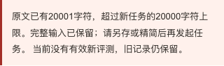

# 大报告往返与新原文容量保护

2026-11-09，开发分支追加修复，尚未合并或发布。原始评分、内容标识及原始粘贴不改。

## 两个实际边界问题

1. 合法的约400KB旧材料可以导入，但单篇复核／资料库下载会同时包含原文及 `transport.raw`、`transport.normalized`。文件超过1MB后，原上传入口按整个信封拦截，导致自己的文件无法读回。
2. 主原文编辑器能接收超过20000字符的新草稿，却到外部任务／接口才拒绝，编辑位置没有即时容量说明。

## 报告信封不等于扩大原材料容量

原始材料仍限1MB。自家单篇报告有独立的12MB外层上限，用于JSON字符串转义、原始传输记录和有界人工说明。接受大报告还必须同时通过：

- 原文＋原始结果的核心材料不超过1MB；公共结构校验也用于资料库、对照和文稿容器，不能借内部信封放入更大的原材料。
- 必须包含本工具外部资料的内容标识和原始 `transport`；raw仍限1MB，normalized与raw的纯JSON／单代码块去包装结果严格一致。
- 如果原始粘贴是完整v1材料，报告原文和原始结果必须逐字段一致；如果原始粘贴是外部AI结果，匹配结果及允许的模型声明组合，任务原文仍限20000字符。
- 附加字段使用已知信封结构，人工复核／处理项等继续有原有数量与字段上限，额外说明合计最多6MB；未知的大字段不能充当扩容载荷。
- 异步导入重新计算内容标识并核对，不以文件自称“本工具报告”作为真实性认证。

上传／粘贴入口明确区分“原材料1MB／本工具报告12MB”。粘贴区不再为了旧容量属性截断完整报告；校验失败时保留当前材料。原raw、normalized、原始结果、人工判断和声明继续保存，没有通过删除传输元数据来压低文件大小。重复导入不会再套一层更大的raw。

12MB只是有界报告容量，不是外部模型返回的新上限；外部任务的原始返回仍1MB。

## 编辑处的20000字符规则

主原文编辑／待评编辑器保留完整输入，不用 `maxLength` 静默截断。超过20000时就地显示字符数、上限及处理办法；新草稿没有有效模型结果，不能发起新评测或被直接带入新任务。接口动作也在入口重复守卫，不依赖网络调用后拒绝。

未评草稿继续按原有标签页机制保存；刷新后超限全文仍在。精简至20000后恢复任务入口。旧大报告通过原有字节与结构校验后仍可全文复核和导出，容量提示不会删除旧分、旧原文或旧资料库记录。

## 实际验证

当前45项核心检查全部通过：此前43项断言保持，新增2项400KB往返及绕过拒绝检查。改动文件ESLint、TypeScript及webpack静态生产构建通过，已写入 `.nojekyll`。

使用隔离Chrome、1280／390视口，实际操作：

1. 上传约400KB合法旧材料，单篇复核下载及资料库下载均超过1MB。
2. 在干净390浏览器分别重新上传这两种真实下载文件，再次下载；原文、原分、内容标识和raw／normalized保持一致。
3. 上传超过1MB的原始材料仍拒绝，活动材料及资料库逐字保持。
4. 编辑为20001字符：完整输入保留、即时提示、旧结果失效且新任务入口阻断；刷新仍保留20001字符。
5. 精简到20000恢复入口；再次按记录链接打开旧400KB材料，仍能完整复核和导出。
6. 无页面脚本错误、无外部接口请求、无页面横向溢出；未调用付费模型。

[实际字节数和检查摘要](assets/report-envelope-20261109/results.json) · [真实下载文件SHA256](assets/report-envelope-20261109/download-manifest.json) · [45项检查输出](assets/report-envelope-20261109/core-tests.txt) · [生产构建](assets/report-envelope-20261109/build.txt)

大文件下载产物保留在本机 `/tmp/eval-report-envelope-20261109/`，避免向仓库重复提交多份约1.2MB的相同合成文本；仓库保留大小、摘要和可重跑脚本 `scripts/test-report-envelope-browser.mjs`。它们是合成验收输入，不是真实用户资料或模型效果证据。

