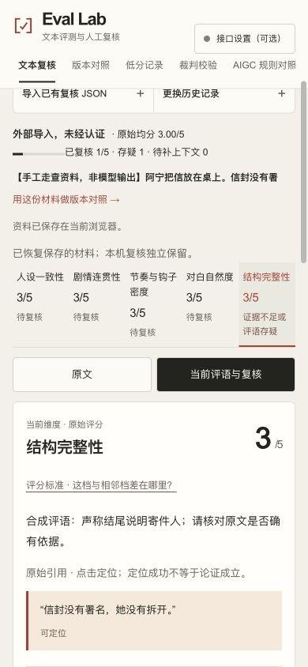

# 任务与评测口径 · 本地验收

2026-11-03。分支 `feat/task-clarity-20261103`，基线 `dc7e271`；本轮未推送、未合并、未发布。

## 行为与取舍

导入格式、五维等权、原始评分及历史记录不变。合法导入收起可再开的表单并聚焦复核；非法输入保留。A/B 选择区压缩，优先打开真实人工存疑／待上下文，其次人机分歧、模型最大分差。可手动切维度。

人工参考分选填1–5整数，与复核状态和独立处理项分开。撤回只去除人工层；模型原分从不覆盖。旧报告没有参考分时显示未填写，不补造差值。汇总的范围是18份内置历史运行＋本机资料库；按记录×五维给出分母，未复核不算证据支持，没有参考分就没有可比较人机差。

新 AIGC 页面使用一个共享输入、两套规则与输出，并列展示五维及可定位引文。所有内容和分数均为人工编写的冻结合成夹具，没有真实模型调用或因果提升结论。V1结构分较高却违反输入约束，演示评分不应替代判断。

导航与原生说明抽屉不修改材料；三步引导可重开。跨工作区入口在新标签打开以保留当前材料。生成 JSON / Markdown 后保留明确保存链接，只说文件已生成，不假定浏览器已落盘。

## 实际操作证据

- 坏均分4与五维3不符：拒绝，表单原文保留，当前旧材料未覆盖。
- 合法手工合成资料：收起表单，焦点实际为 review-workspace；原均分3。
- 结构标存疑、参考2、填备注：原分3保持；JSON文件同时保留3和2，未解决事项在 Markdown 前面。
- 撤回人工层后，从真正保存的 JSON 上传恢复参考2；原分不变，独立处理项保留。
- 自有两份资料比较：结构争议默认展开，其他声明差异照常提醒；对照实物 JSON 可读。
- 手机390宽：点引用到原文，再回当前评语，仍保留维度和参考分；平板820无横向溢出。原生抽屉 Esc、浏览器返回关闭，焦点回触发按钮。
- AIGC两版引文实际可定位，明确合成标签。

## 检查与边界

27项核心／导入／工作流检查、ESLint、TypeScript及生产静态构建通过。原18条回放检查通过，没有新造历史分数；原评分标准未改。测试使用手工合成资料，不是模型效果评测。

未做真机、Safari实机、读屏、减少动态效果的运行时切换或独立用户研究。存储不可用及容量／坏文件边界主要由现有确定性测试覆盖，不冒充浏览器实测。独立逐项复验是后续门禁。
