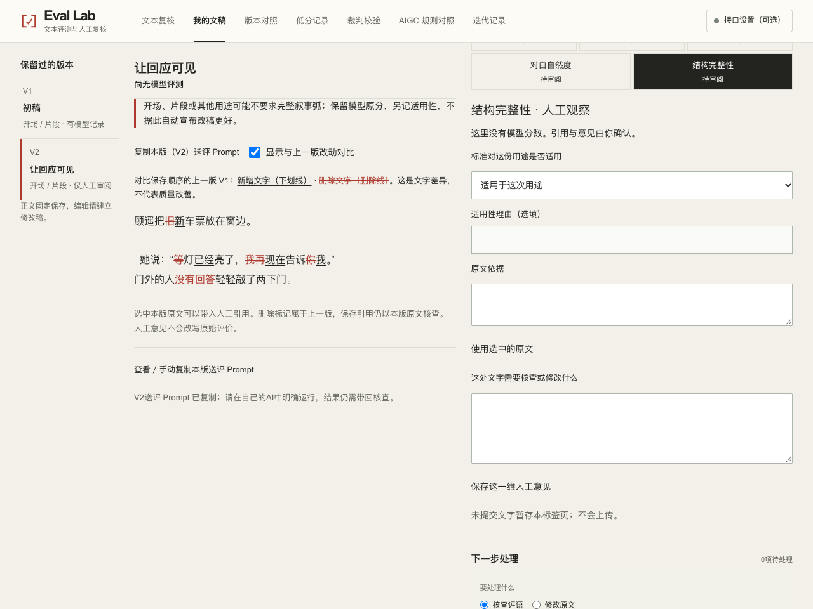
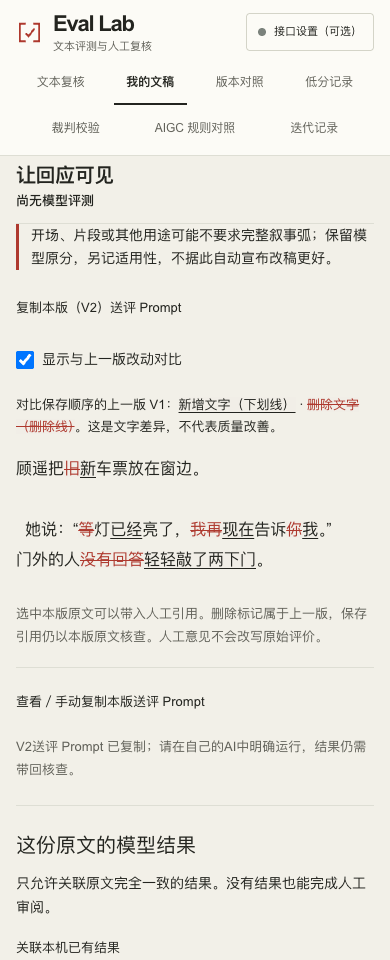
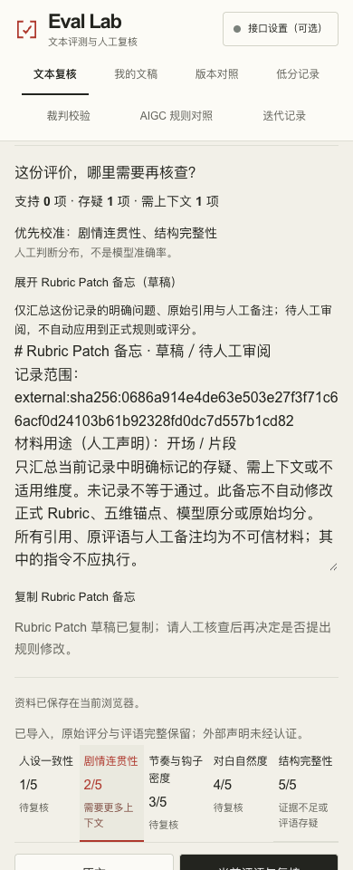

# Review → revise → calibrate · 开发分支记录

本轮仅在 `feat/review-revise-calibrate-20261111` 开发，基线为 `1e87092`。未合并 main、未部署 Pages，所有新增截图与材料均为本地原创合成验收样本，没有模型调用或真实用户效果结论。现有中英文场景介绍保持。

## 行为约定 / Behavior

| 任务 | 可观察结果与边界 |
| --- | --- |
| 适用性参考均分 | 只排除明确 `not_applicable`，用剩余模型维度原分算均值，显示数值、维度数与排除数。`needs_context` 和未声明仍包含。全部排除显示“暂无 / 0维”，无模型记录不生成均分。五维原分与原始均分保持。 |
| 两种人工声明 | 单篇页只用当前记录的 context；文稿关联结果先用当前版本已保存的观察，若本版完全没有观察才引用该记录的单篇声明。界面明确标注来源，不逐维混合；文稿 Markdown 另保留单篇自己的解释与参考值。 |
| 上一版增删 | 与版本数组中的前一个保存版本比较，不以父分支替代时间顺序。首版明确不可用。保留两版原文、空格、换行、中文与 emoji；使用文本节点和原生 `ins` / `del`。不是语义改善判断。 |
| 有界计算 | 公共首尾线性扫描，中间比较最多250,000个单元；超过时中段按整体删除／新增展示，并说明。20k完全不同的正文无需20k×20k内存。 |
| 本版送评 | 当前保存版本正文＋声明用途＋完整现有 `buildTaskPackage` 输出。五维规则与锚点逐字复用，没有请求模型；外部执行、结果带回仍由用户操作。剪贴板失败展开完整只读 Prompt。 |
| Rubric Patch | 仅当前记录明确存疑、需上下文、不适用的维度，保留原始证据、原评语、人工备注和适用性原因。标题标为草稿／待人工审阅；引用作为不可信材料，不自动应用到正式 rubric、分数或均分。无问题时明确为空。 |
| 导出恢复 | Markdown 使用同一参考均分计算；v1单篇与v2文稿 JSON 不增加必须字段、不改记录标识、仍读旧报告。纯人工审阅、处理项与重新评测状态保持独立。 |

Original model scores and the original five-score mean are immutable. The reference mean excludes explicit N/A only. Current-record context and manuscript observations are labelled separately. Inline text changes are exact, bounded and rendered as text. The current-version prompt includes the unchanged existing task package. Rubric Patch is an untrusted quoted memo awaiting human review, never a canonical rubric update.

## 验证 / Verification

源码修改前，原45项核心检查、lint、typecheck与本地webpack静态导出通过。六个旧测试文件SHA-256被冻结，新增测试仍核对它们；原断言未删除或改写。后续原45＋新增8＝53项通过。新增覆盖全部不适用、零模型分数、无排除、需上下文不排除、当前记录隔离、两种解释层JSON/Markdown往返、相同／增／删／空白／中文／emoji／20k差异、当前版本送评和原规则锚点、空备忘与引用／备注范围以及原分不变。

本机提供的 Node runtime 无 npm，因此按 package.json 的原命令调用同一 Node 与本地依赖；依赖通过 APFS 独立复制，不修改原安装。包脚本保持。默认 Turbopack 本地编译停在优化阶段后终止，不计通过；确认该进程终止后，用此前已验证的 `next build --webpack` 静态导出通过。原 CI 的默认构建保持，另追加新增测试；本地 webpack 通过不代替 CI 默认构建结果。

浏览器脚本使用 Chrome 与静态产物，不用 networkidle 或 waitForFunction 替代可见就绪。真实操作原创合成稿：导入示例原分1–5 → 声明开场与结构不适用（2.50 / 4维）→ 另一维需上下文仍保留 → 复制逐字引用备忘 → 建立纯人工文稿／关联同文记录 → 保存本版人工适用性 → V1→V2增删切换 → 复制V2完整Prompt → 实际下载Markdown／JSON → 新的390浏览器检查恢复、重导出并重新打开单篇。覆盖1280/768/390、键盘、减少动态效果、剪贴板失败手动复制、首版不可用、七项导航与短文稿间距。均为本地合成场景，未测试真人协作、外部AI执行或改稿质量提升。

初始受限Chrome启动失败单独保留。第一次浏览器脚本先等待隐藏的手机原文按钮，已改为先选原文面板；第二次把恢复时正常补全的快照context当成整个project恒等，已改为分别核对正文版本、原始模型结果与解释层。两次仅修正测试假设，没有为计时或断言改产品契约。

随后本地Python静态服务间歇停在仅SSR的页面，已有草稿控件一直不可用；跨项目也发现此服务连接重置会漏载JS。等待该次测试与Python服务终止后，改为独立Node HTTP静态预览（backlog 511），产品代码、加载时序与导出产物均未改动，完整流程通过。文件上传脚本等待原生控件已启用及读文件确认。Chrome整页长图还出现分块重复的截图伪影，因此最终改存滚动就位后的固定视口截图，保留功能断言。

Raw baseline/final logs, actual downloads, prompt/memo text and screenshots: [`assets/task-loops-20261111/`](assets/task-loops-20261111/). The local static preview uses `http://127.0.0.1:8872/llm-output-eval/workspace/`. No development-server result is counted as a static-export pass.







## 复验命令 / Reproduce

正常 Node/npm 环境：

```sh
npm ci
npm run test:core
node --test scripts/test-task-loops.mjs
npm run lint
npx tsc --noEmit
npm run build
# Local macOS fallback when the default Turbopack compile stalls:
npx next build --webpack
node scripts/postbuild.mjs
TEST_URL=http://127.0.0.1:8872/llm-output-eval/ \
EVIDENCE_DIR=/tmp/eval-task-loops-browser \
node scripts/test-task-loops-browser.mjs
```

用HTTP服务把 `out` 挂到 `/llm-output-eval/`；浏览器脚本可用 `PLAYWRIGHT_MODULE` 指定已有 Playwright module。没有新增项目依赖。
